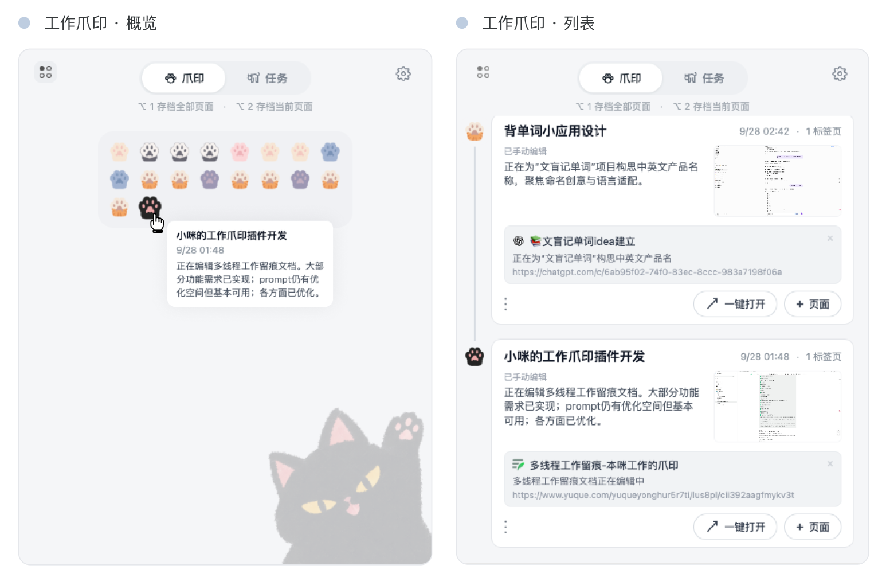
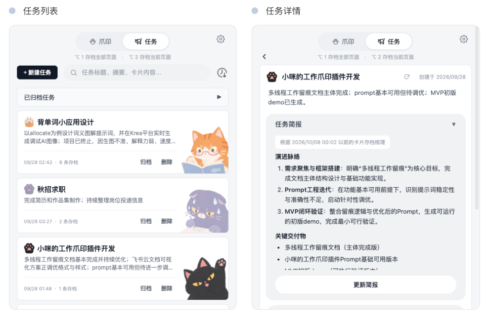

# 小咪的工作爪印 · PawPrint

> 一只小猫咪，在你工作的路上踩下一串串爪印——把你散落在浏览器里的标签页、截图和思路，按任务一只只收好。需要时，顺着脚印回去，就知道上次停在哪、接下来该往哪走。


## 这是什么

**小咪的工作爪印** 是一款 Chrome 扩展，用来把「正在进行的工作」从杂乱的浏览器标签页里捞出来，按任务归档成可以回看、接续和复盘的工作片段。

它不要求你先规划好一套任务体系再开工。你照常浏览、照常切换；想停就存一下，小咪替你把当下的窗口状态踩成一枚爪印。等要回顾或接续时，每一枚爪印都还在原地等你。

## 为什么做它

现在的任务管理工具越来越重、越来越「模板化」，我们常常被塞进别人定义好的框架里，被 DDL 和 Todo 推着走。而真实的工作往往是：

- **碎片化、多线程**：一件事做到一半就被打断，切去处理别的，再切回来时得重新「热脑子」——回想上下文、找回上次的状态才能接续；
- **复盘困难**：等想梳理一整段工作流程时，线索早就散落在几十个历史标签页和记忆里，拼不回来。

小咪的工作爪印想做一点「去结构化」的尝试：不强迫你先建好项目再填内容，而是先把工作片段**收集**下来，最后才顺着爪印把它们**梳理**成一段完整的工作流。

## 它能帮你什么

1. **工作精力分配可视化**：每个任务下攒了多少枚爪印、分布在什么时间，一眼可见，方便回顾你把时间花在了哪。
2. **放心暂停**：任何任务想停就停——因为下次回来，你能立刻看到上次的进展并无缝接续，不再有「热脑子」的成本。
3. **片段聚成流程**：零散的工作片段被按任务聚拢后，可以回溯、梳理成一整段清晰的工作流总结。
4. **AI 帮你写概要**：开启 AI 后，扩展会为每个任务调用大模型生成一段工作概要，省去手动整理的麻烦。

## 功能一览

### 🐾 一键存档
- `Alt + 1`（Mac）/ `Ctrl + Shift + 1`（Windows / Linux）：保存**当前整个窗口**的工作状态（所有标签页 + 活动页截图）。
- `Alt + 2`（Mac）/ `Ctrl + Shift + 2`：只存档**当前活动标签页**。

### 🗂 任务分类
- 存档的卡片会自动归入对应任务，也能手动改分类、更换任务图标。
- 支持把卡片在任务之间移动；对于「系统误判、自动新建且从未手动编辑、仅含一张卡片」的分类，当这张卡片被移走时会自动清理，不给列表留垃圾。

### 🧠 AI 智能概要
- 在设置里填入自己的 API Key 并开启 AI 后，扩展会为每个任务调用大模型生成工作概要。
- 概要在你手动编辑后会「锁定」，避免被自动覆盖；任务详情页标题旁有刷新按钮，可随时强制重新生成并解除锁定。

### 🐾 轨迹概览（折叠时间线）
- 把同一任务的存档卡片沿**时间线**排列，标签（label）图标串成一条轨迹。
- **折叠态**：只露出一排 label 小图标，悬停任一图标即可预览该次存档的任务名、时间与概要，不挡正文。
- **展开态**：卡片沿时间线铺开，连接线指示时间流向，方便看清一段工作的来龙去脉。

### 📋 任务详情与待办
- 进入任务详情可查看标题、图标、AI 概要，并维护一份**待办清单**（增删改、拖拽排序）。
- 支持任务归档 / 取消归档、删除。

### 💾 本地优先，隐私友好
- 所有存档数据保存在浏览器本地（`chrome.storage`），**不上传任何服务器**。
- AI 概要使用你**自己的** API Key，由扩展直连你配置的大模型，密钥不经过第三方。

## 安装

1. **下载项目**：在本仓库页面点击 `Code → Download ZIP` 下载并解压，或克隆到本地：
   ```bash
   git clone https://github.com/LiuHuaying999/PawPrint.git
   ```
2. 打开 Chrome，进入 `chrome://extensions/`；
3. 右上角开启「开发者模式」（Developer mode）；
4. 点击「加载已解压的扩展程序」（Load unpacked），选择**解压后的项目根目录**（即包含 `manifest.json` 的文件夹）；
5. 扩展图标出现在工具栏后，即可开始使用。

> 如需更新：拉取最新代码后，在 `chrome://extensions/` 找到本扩展，点击刷新图标即可。

## 使用

安装完成后，即可按以下步骤开始使用：

1. 先到扩展设置里填入你自己的 API Key 并开启 AI（点击工具栏图标 → 设置）；不配置也能用基础存档与回顾，只是没有 AI 概要；
2. 工作到某个节点，按下 `Alt + 1`（Mac）存下当前整个窗口；
3. 在弹出的面板里能看到刚踩下的爪印，可归入任务或保持未分类；
4. 想回顾时，点工具栏的「轨迹概览」按钮，把存档折叠成时间线，顺着 label 找那枚爪印；
5. 进入任务详情做复盘、写待办、看 AI 概要。

## 界面预览

**工作爪印 · 概览 / 列表**：折叠态下沿时间线排布的一串爪印（概览），以及展开后的完整存档列表。



**任务列表 / 任务详情**：按任务聚合的存档总览，以及进入某个任务后的详情页（标题、图标、AI 概要、待办清单）。



## 文件结构

```
tasksaving/
├── manifest.json       # 扩展配置（权限、快捷键、图标等）
├── background.js       # 后台 Service Worker：存档、AI 概要、消息中枢
├── popup.js            # 弹出面板逻辑：卡片、任务、轨迹时间线、详情
├── popup.css           # 弹出面板样式
├── popup.html          # 弹出面板结构
├── content.js          # 内容脚本（页面内交互）
├── icons/              # 图标与 label / 任务图片资源
└── README.md
```

## 注意事项

- **图标**：项目已自带 `icons/` 下的图标资源，无需额外添加。
- **截图范围**：截图功能仅对当前可见的活动标签页有效。
- **AI 功能**：需自行在扩展设置中配置 API Key 并开启 AI；未配置时不影响基础存档与回顾功能。
- **快捷键冲突**：若系统或其他扩展占用了默认快捷键，可在 `chrome://extensions/shortcuts` 中重新指定。

## 隐私

本扩展**不收集、不上传**你的任何浏览数据。所有存档仅存于你本机浏览器；启用 AI 概要时，仅你的存档文本会按你的配置直连你所选的大模型，密钥由你掌管。
